# Visualization

The example plots below were created using the [example data](../examples/example-data.md)

## Composition plots

::: hide_deconv.visualization.plot_pca

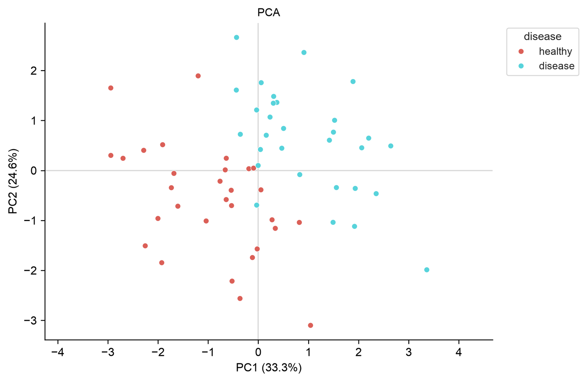

::: hide_deconv.visualization.plot_umap

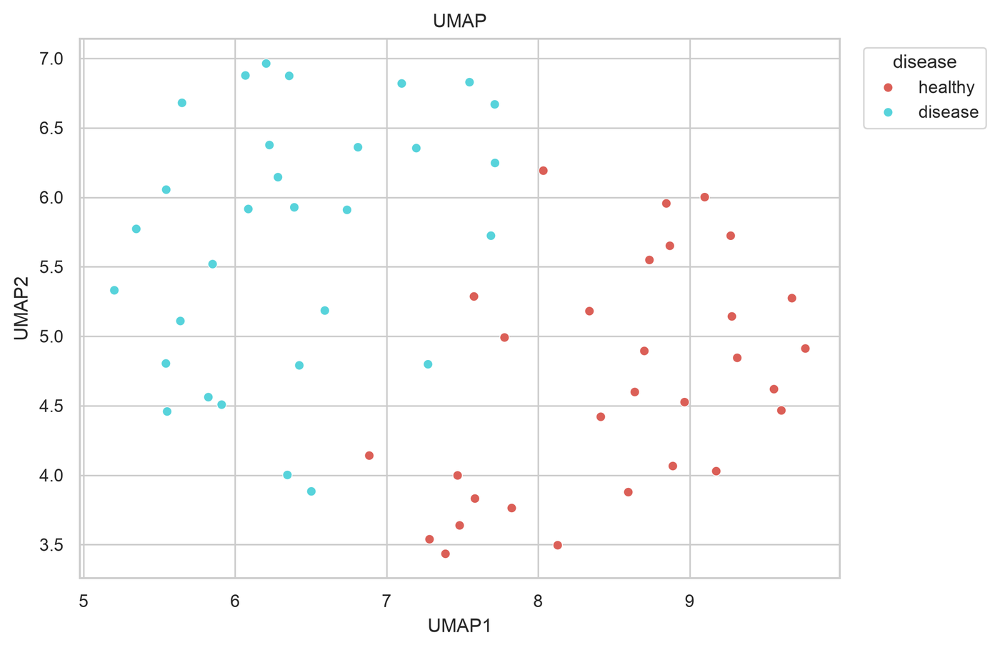

::: hide_deconv.visualization.plot_kmeans_pca

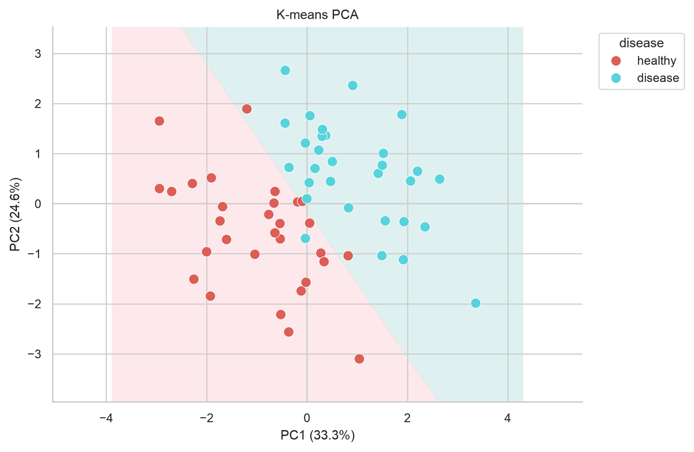

::: hide_deconv.visualization.plot_celltype_bar_scatter

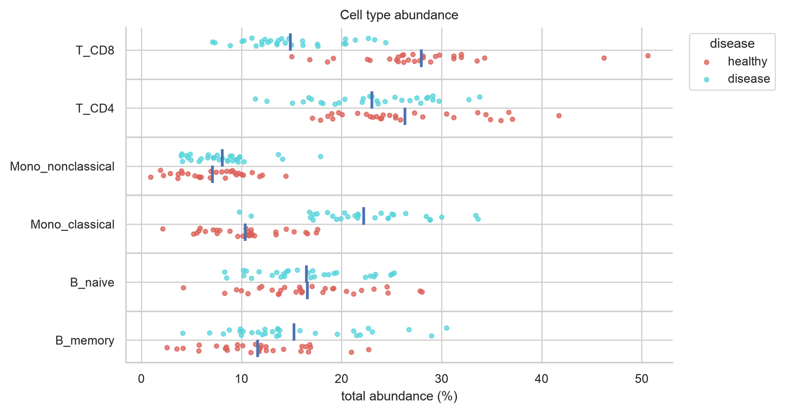

::: hide_deconv.visualization.plot_eval

::: hide_deconv.visualization.plot_hier_heat

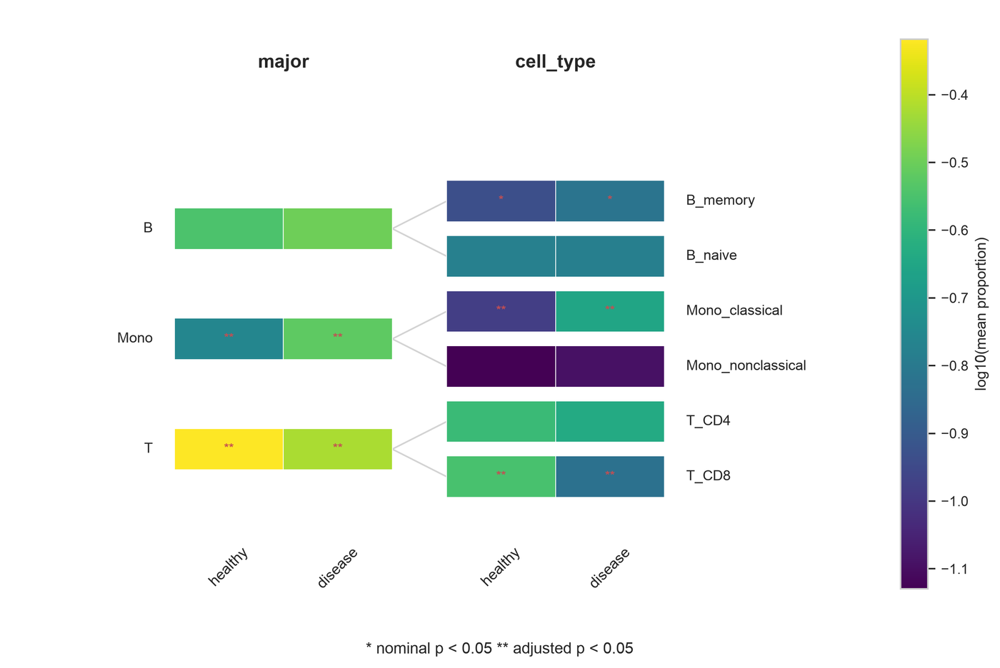

::: hide_deconv.visualization.plot_genemap

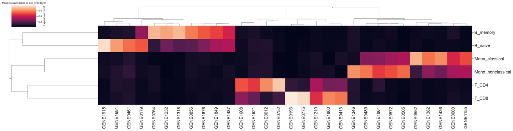

::: hide_deconv.visualization.plot_volcano

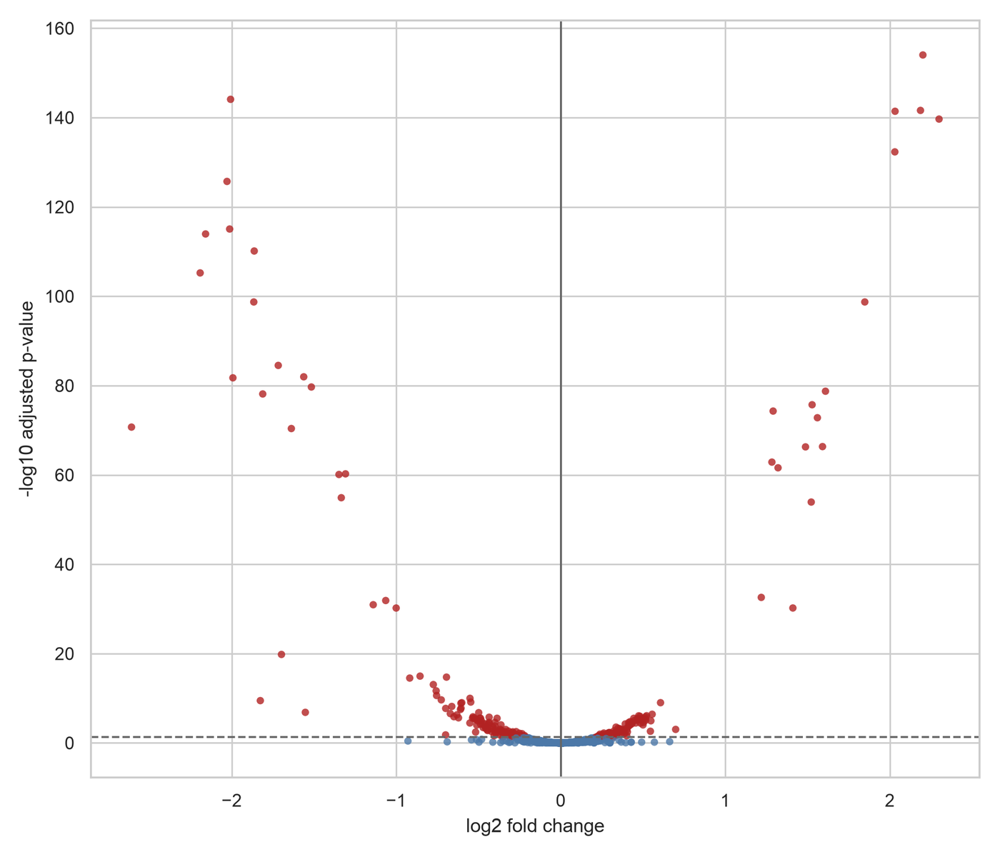

## PLS-DA plots

::: hide_deconv.visualization.plot_plsda_score

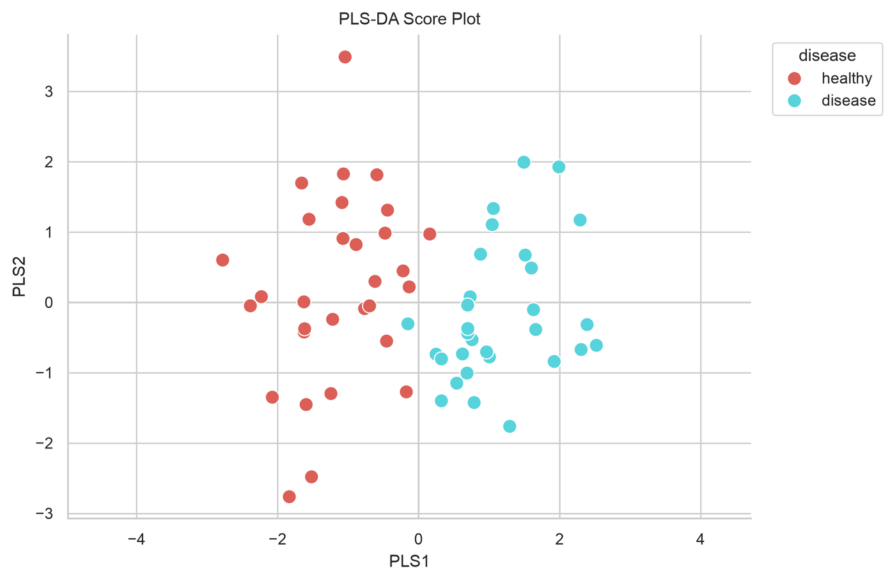

::: hide_deconv.visualization.plot_plsda_loading

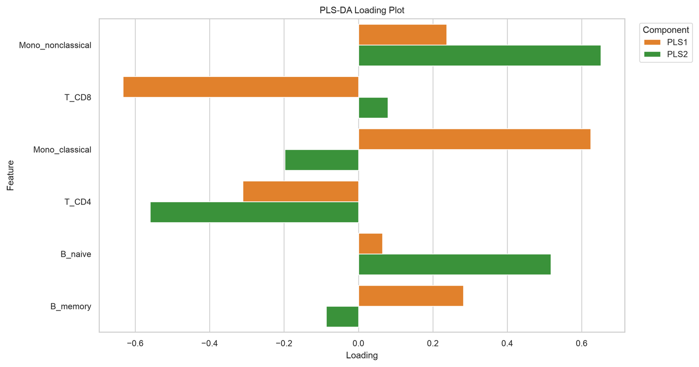

::: hide_deconv.visualization.plot_plsda_vip

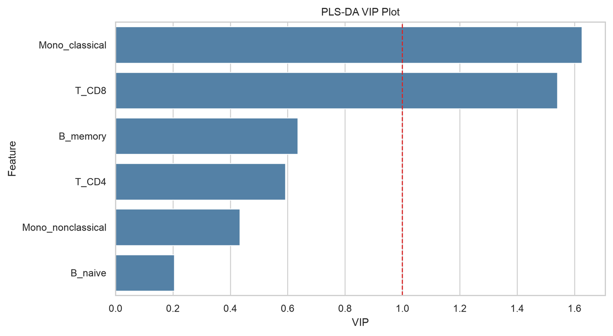

::: hide_deconv.visualization.plot_plsda_biplot

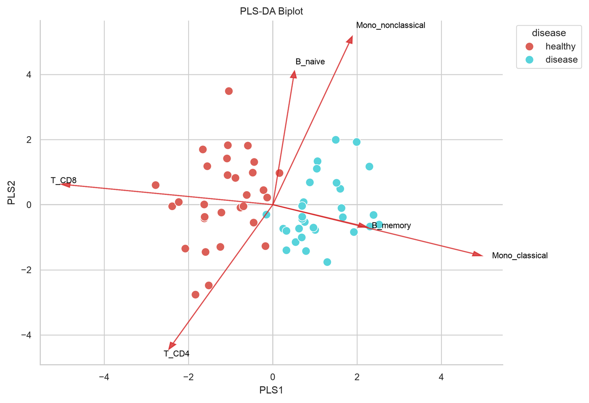

## Survival plots

::: hide_deconv.visualization.plot_kaplan_meier_comp

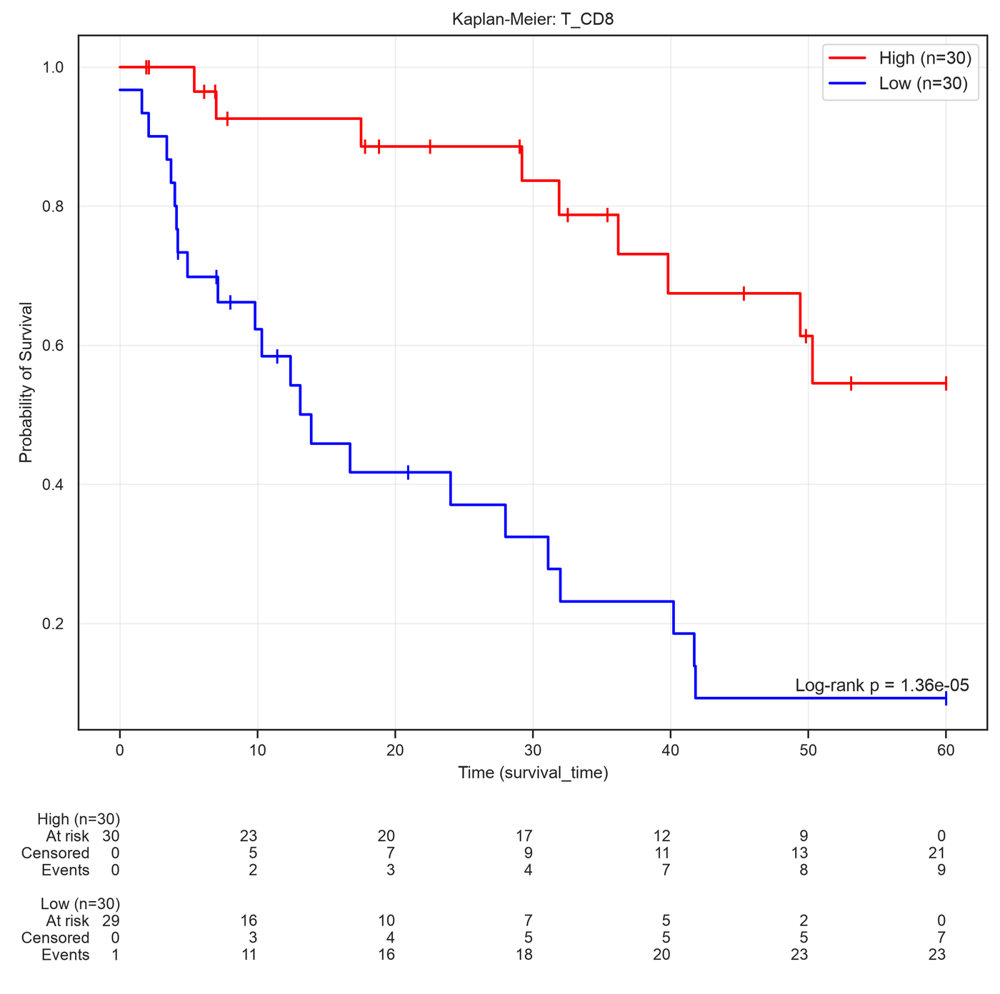

::: hide_deconv.visualization.plot_kaplan_meier_cohort

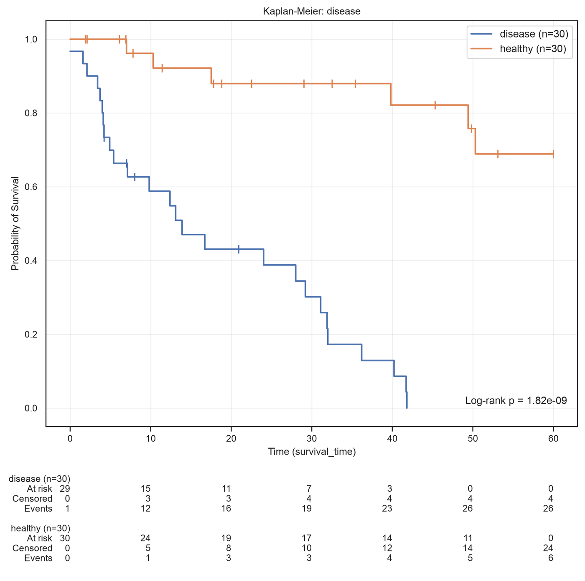

::: hide_deconv.visualization.plot_cox_forest

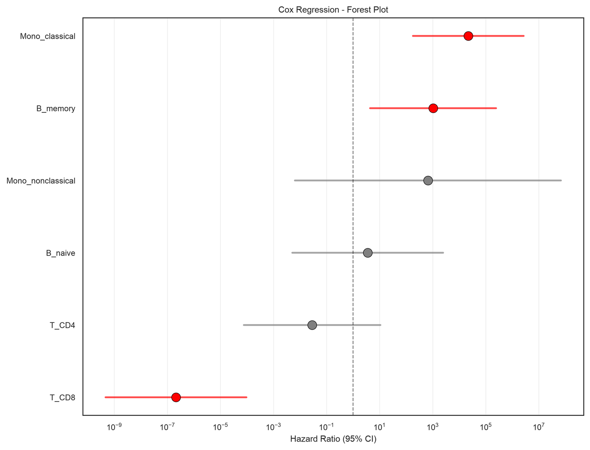

## AnnData plots

::: hide_deconv.visualization.plot_anndata_umap

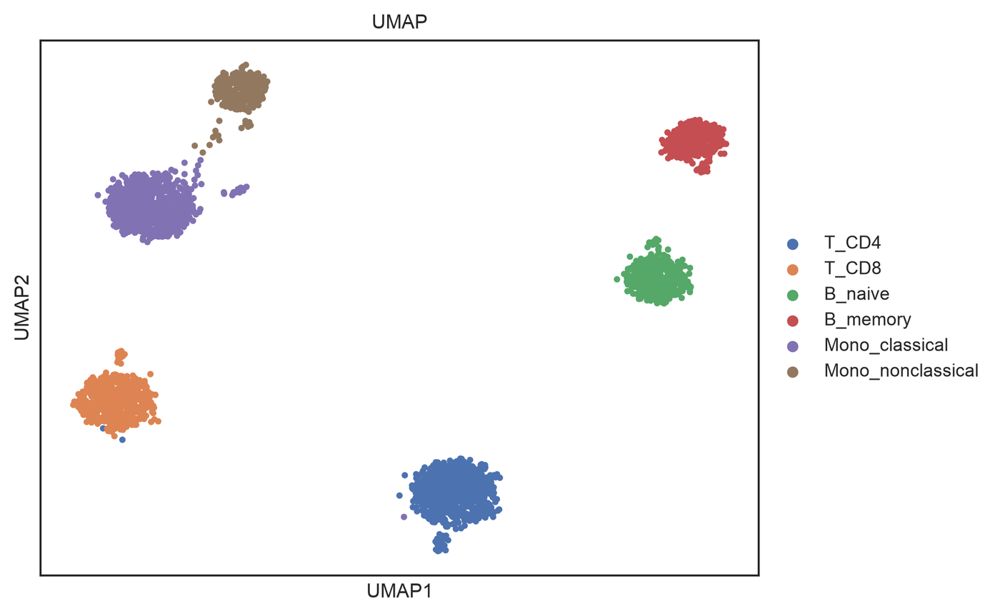
